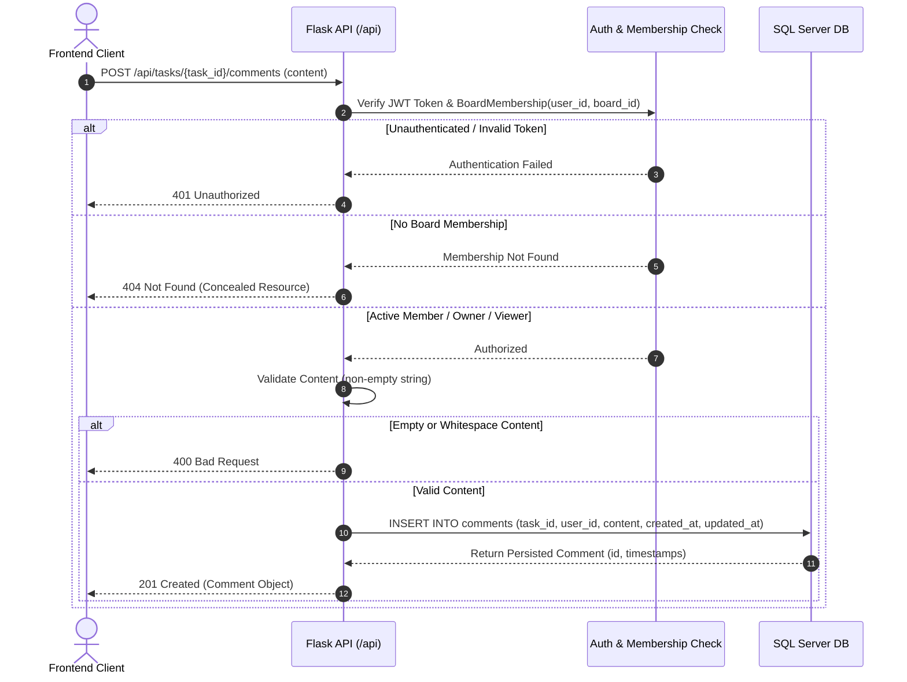
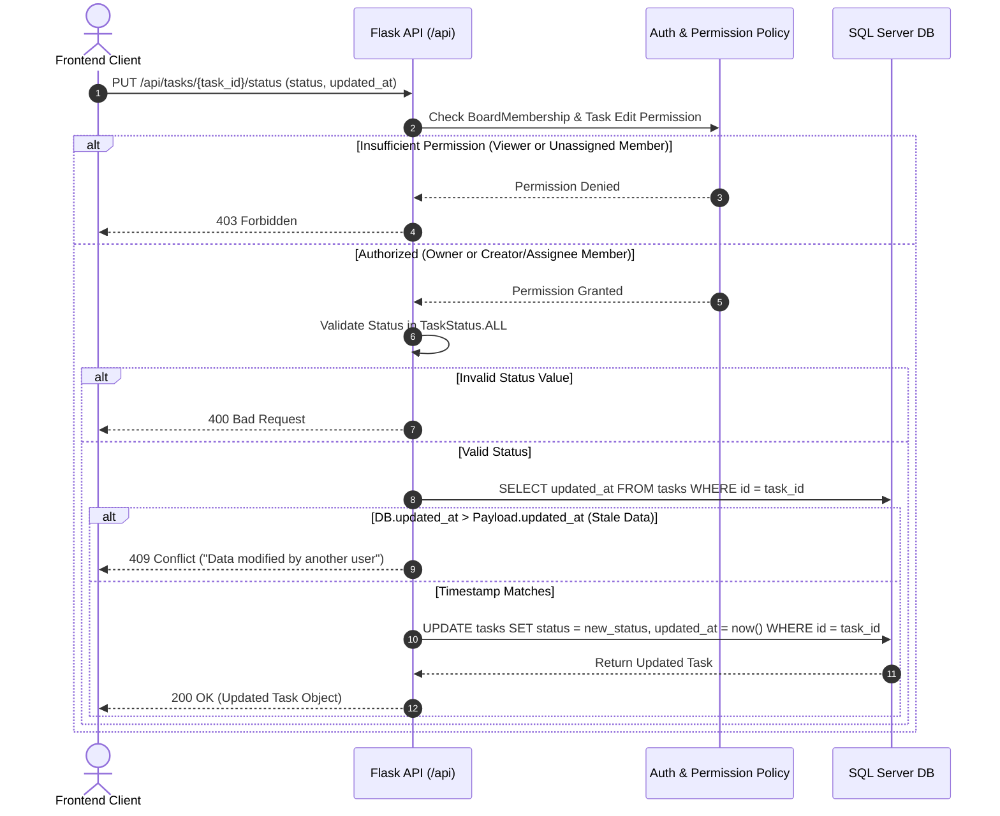
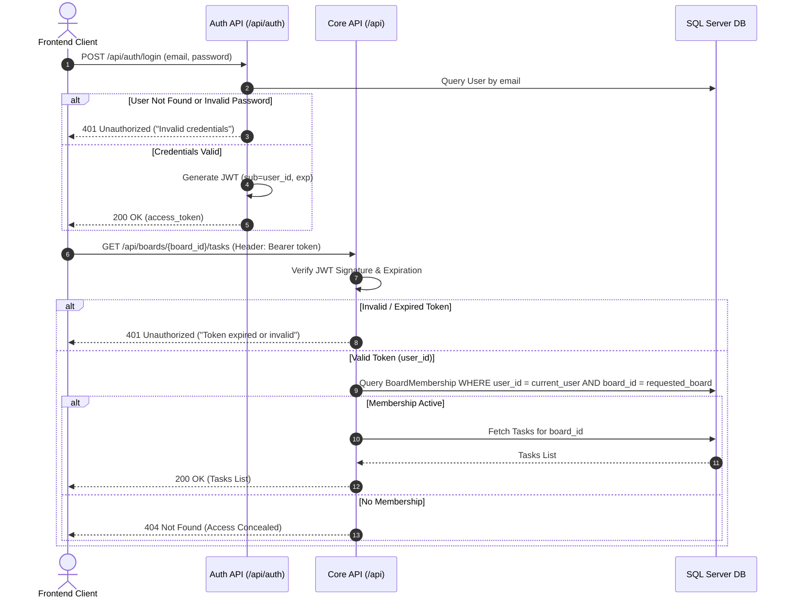

# Team Task Board — API Sequence Flows

**Version:** 1.0  
**Status:** Approved Reference  
**Reference Documents:** [docs/business_rules.md](file:///home/igtanova/Documents/NCKH/Team-Task-Board/docs/business_rules.md), [docs/api_contract.md](file:///home/igtanova/Documents/NCKH/Team-Task-Board/docs/api_contract.md)

---

## Overview

This document details the interaction flows between Frontend, API Gateway/Blueprint, Authentication Service, Permission Policy, and Database Layer using **Mermaid Sequence Diagrams**.

---

## 1. Comment Creation Flow

1. Client sends a request to post a comment.
2. API verifies authentication and board membership.
3. API validates content non-emptiness.
4. Database persists the comment associated with the authenticated user ID.

---

## 2. Status Update & Concurrency Flow (OCC)

1. Client sends status update with previously read timestamp/version.
2. API verifies board membership and task-level update permissions:
   - `Owner`: Allowed for all tasks in board.
   - `Member`: Allowed only if `created_by == current_user` OR `assigned_to == current_user`.
3. API validates status enum value (`todo`, `in_progress`, `review`, `done`).
4. API verifies concurrency token (`updated_at` / version).
5. If stale, returns `409 Conflict`. Otherwise, updates status atomically.

---

## 3. JWT Authentication & Authorization Flow

1. User logs in with email/password and receives a signed JWT token.
2. Client attaches `Authorization: Bearer <token>` on protected requests.
3. Server decodes JWT to get `user_id`.
4. Server queries active `BoardMembership` for authorization decision.

