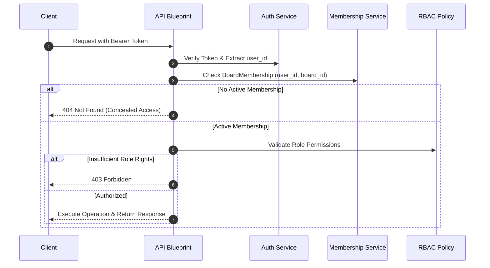
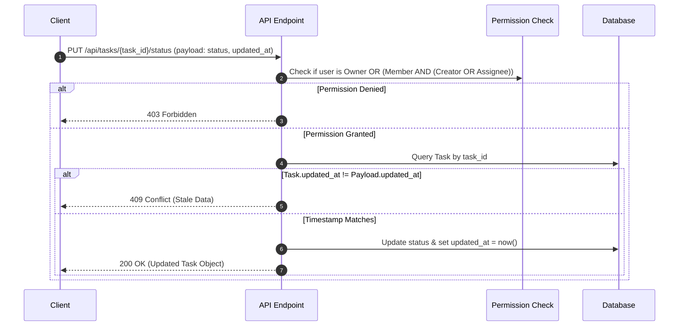
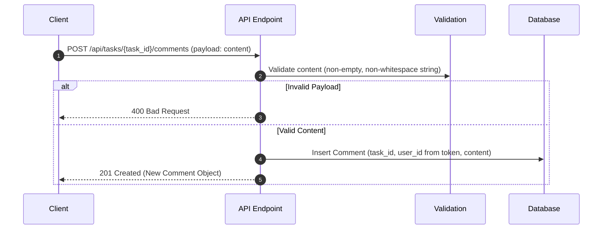

# Team Task Board — REST API Contract

**Version:** 1.1 (Lean & Synchronized)  
**Status:** Active Baseline — Week 1 Scope  
**Base URL:** `/api`  
**Reference:** Business Rules Specification v1.2 (Lean)

---

## 1. Overview

This document specifies the REST API contract for the Team Task Board. It defines request formats, direct JSON responses, validation rules, HTTP status codes, and sequence flows.

### 1.1. Response & Error Conventions (Direct JSON)

Endpoints return standard HTTP status codes and direct JSON payloads without custom envelope wrappers (`{"success": true, ...}`).

- **Success (`200 OK` / `201 Created`):** Returns requested data directly.
- **Error (`4xx` / `5xx`):** Returns error details using a standard error object:

```json
{
  "detail": "Error message describing the failure."
}
```

### 1.2. Standard HTTP Status Codes

| Code | Meaning | Usage |
|---|---|---|
| 200 | OK | Successful retrieval or status update |
| 201 | Created | Resource successfully created |
| 400 | Bad Request | Validation error (e.g. invalid status, empty comment) |
| 401 | Unauthorized | Missing or invalid authentication token |
| 403 | Forbidden | User lacks permission for this resource/action |
| 404 | Not Found | Resource does not exist or access is concealed |
| 409 | Conflict | Stale concurrency timestamp (`updated_at` mismatch) |
| 415 | Unsupported Media Type | Request header `Content-Type` is not `application/json` |
| 500 | Internal Server Error | Unexpected server error |

---

## 2. System Flow Diagrams (Mermaid)

### 2.1. Request Authentication & Authorization Flow



### 2.2. Task Status Update & OCC Flow



### 2.3. Comment Creation Flow



---

## 3. Endpoints Specification (Week 1 Scope)

### 3.1. GET Board Tasks

**Endpoint:** `GET /api/boards/{board_id}/tasks`  
**Access:** Owner, Member, Viewer (active board members)

#### Response (`200 OK`)

```json
[
  {
    "id": 10,
    "title": "Implement login API",
    "description": "Create REST blueprint for authentication",
    "status": "todo",
    "priority": "high",
    "board_id": 1,
    "assigned_to": 3,
    "created_by": 2,
    "created_at": "2026-10-10T07:00:00Z",
    "updated_at": "2026-10-10T07:00:00Z"
  }
]
```

*Note: If no tasks exist on a valid board, returns an empty array `[]`.*

---

### 3.2. PUT Task Status

**Endpoint:** `PUT /api/tasks/{task_id}/status`  
**Header:** `Content-Type: application/json`  
**Access:** Owner; or Member if Creator/Assignee

#### Request Body

```json
{
  "status": "done",
  "updated_at": "2026-10-10T07:00:00Z"
}
```

- `status` (string, required): Allowed values are `"todo"`, `"in_progress"`, `"review"`, `"done"`.
- `updated_at` (string, required): ISO 8601 timestamp previously read by the client for concurrency validation.

#### Response (`200 OK`)

```json
{
  "id": 10,
  "status": "done",
  "updated_at": "2026-10-10T08:15:30Z"
}
```

#### Error Response (`409 Conflict`)

```json
{
  "detail": "Task was modified by another user. Reload latest data."
}
```

---

### 3.3. POST Task Comment

**Endpoint:** `POST /api/tasks/{task_id}/comments`  
**Header:** `Content-Type: application/json`  
**Access:** Owner, Member, Viewer (active board members)

#### Request Body

```json
{
  "content": "Please review the status transition logic."
}
```

- `content` (string, required): Non-empty, non-whitespace comment text. `user_id` is automatically bound from the authentication token.

#### Response (`201 Created`)

```json
{
  "id": 25,
  "task_id": 10,
  "user_id": 3,
  "content": "Please review the status transition logic.",
  "created_at": "2026-10-10T08:20:00Z",
  "updated_at": "2026-10-10T08:20:00Z"
}
```

---

## 4. Module Integration Boundaries

- **Auth Module:** Provides token validation and extracts current `user_id`. Does not enforce board permissions.
- **Board/Task Module:** Enforces role-based permissions (`BoardMembership`), validates input fields, and manages Task/Comment state transitions.
- **Database Layer:** Manages persistence, relationship constraints (`ON DELETE CASCADE`), and supplies accurate `updated_at` timestamps.

---

## 5. Deferred Endpoints (Future Scope)

- `GET /api/tasks/{task_id}` (Task detail)
- `GET /api/tasks/{task_id}/comments` (Paginated comments)
- `PATCH /api/tasks/{task_id}` (Edit task details)
- `PATCH / DELETE /api/tasks/{task_id}/comments/{comment_id}` (Modify/remove comment)
